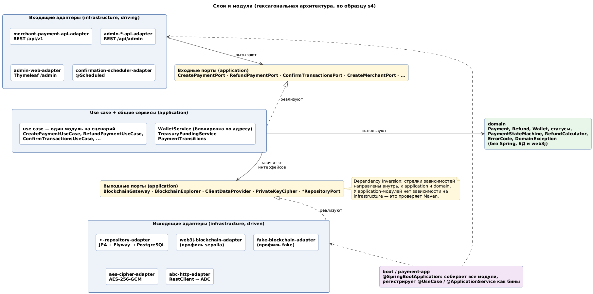
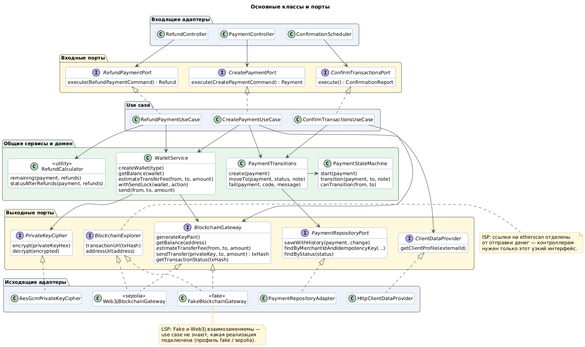

# Архитектура: Crypto Payment Service

Документ для защиты: как устроен сервис, какие решения приняты и почему, где в коде какой принцип SOLID.
Требования — в [`requirements.md`](requirements.md), исходники диаграмм — в [`diagrams/`](diagrams) (`.puml` + `.png`/`.svg`).

## 1. Общая схема

Сервис построен по **гексагональной архитектуре** (ports & adapters). Бизнес-логика находится в центре и зависит
только от интерфейсов (портов). Всё внешнее — HTTP, база, блокчейн, шифрование, сервис ABC — подключается адаптерами.

| Слой | Что внутри | От чего зависит |
|---|---|---|
| `domain` | модели (`Payment`, `Refund`, `Wallet`, ...), статусы, `PaymentStateMachine`, `RefundCalculator`, `ErrorCode`, `DomainException` | ни от чего (только Lombok и генератор UUID) |
| `application` | use case (по одному модулю на сценарий), порты, общие сервисы `WalletService`, `TreasuryFundingService`, `PaymentTransitions` | от `domain`; **не** от Spring, БД и web3j |
| `infrastructure` | адаптеры: REST, Thymeleaf, планировщик, JPA + Flyway, web3j, fake-блокчейн, AES, HTTP-клиент ABC, Spring Security | от портов `application` |
| `boot` | `payment-app`: точка входа, конфигурация, обработчик ошибок | от всего: собирает приложение |

### Модули (по образцу проекта s4)

Проект — многомодульный Maven, всего 56 модулей: `domain`, 32 в `application`, 21 в `infrastructure`, 2 в `boot`.

- **Use case — отдельный модуль на сценарий** (18 штук): `create-payment-use-case`, `refund-payment-use-case`,
  `confirm-transactions-use-case`, `create-merchant-use-case`, ... В каждом модуле входной порт (`CreatePaymentPort`),
  команда/результат и реализация (`CreatePaymentUseCase`).
- **Выходные порты сгруппированы по агрегату**: `payment-repository-port`, `wallet-repository-port`,
  `blockchain-gateway-port`, `client-data-port`, `private-key-cipher-port`, ...
- **Адаптер — отдельный модуль**: `payment-repository-adapter`, `web3j-blockchain-adapter`, `fake-blockchain-adapter`,
  `merchant-payment-api-adapter`, `admin-web-adapter`, ...

Такое разбиение — не формальность: правило зависимостей проверяет **Maven**. У модуля `create-payment-use-case`
просто нет зависимости на web3j или JPA, поэтому импортировать их в бизнес-логику невозможно — проект не соберётся.

### Как Spring собирает приложение без Spring в application-слое

Классы use case помечены собственной аннотацией `@UseCase`, общие сервисы — `@ApplicationService`
(обе из `application-common`, это обычные Java-аннотации). `PaymentApplication` сканирует пакет с фильтром по этим
аннотациям, а доменные классы (`PaymentStateMachine`, `Clock`, настройки) создаёт `DomainServiceConfiguration`.
Зависимости внедряются через конструктор, поэтому use case легко создать в unit-тесте без Spring.

### Основные классы

## 2. Сценарии

| Сценарий | Диаграмма | Ключевые классы |
|---|---|---|
| Оплата + подтверждение | [sequence-payment](diagrams/sequence-payment.png) | `PaymentController` → `CreatePaymentUseCase` → `PaymentTransitions`, `WalletService`, `ClientDataProvider`, `BlockchainGateway` |
| Возврат + подтверждение | [sequence-refund](diagrams/sequence-refund.png) | `RefundController` → `RefundPaymentUseCase` → `WalletService`, `RefundCalculator` |
| Статусы платежа | [state-payment](diagrams/state-payment.png) | `PaymentStateMachine`, `PaymentTransitions` |
| Статусы возврата | [state-refund](diagrams/state-refund.png) | `Refund.markPending/complete/fail` |

Один и тот же use case вызывается из разных входных адаптеров: оплата — из REST (`PaymentController`) и из
админ-панели (`AdminTestPaymentController`), подтверждение — из планировщика (`ConfirmationScheduler`) и из теста.

## 3. Ключевые решения

### 3.1. Кастодиальная модель и три типа кошельков
Кошельки генерирует сам сервис (`BlockchainGateway.generateKeyPair()` → web3j `Keys.createEcKeyPair()`),
адрес выводится из ключа. Пользователю не нужен свой кошелёк (MetaMask и т. п.) — для учебной платёжной
системы это проще и соответствует тому, как работают биржи и платёжные шлюзы.

- **Treasury (казна)** — одна на систему, создаётся при первом старте (`InitTreasuryUseCase`, `TreasuryInitializer`).
  Единственный кошелёк, который пополняется из крана.
- **Client** — с него списываются платежи.
- **Merchant** — на него приходят платежи, с него уходят возвраты; при создании получает ETH из казны на комиссии.

**Почему казна:** кран выдаёт мало и не чаще раза в сутки. С казной кран нужен один раз, а клиенты и мерчанты
пополняются из неё одной кнопкой (`TreasuryFundingService`). Уникальный частичный индекс в БД гарантирует,
что казна ровно одна.

### 3.2. Шифрование приватных ключей
- Ключ хранится только зашифрованным: **AES-256-GCM** (`AesGcmPrivateKeyCipher`), мастер-ключ — 32 байта
  из `WALLET_ENCRYPTION_KEY`.
- **Почему GCM:** кроме шифрования он проверяет целостность (тег 128 бит) — подменённый в БД шифртекст не
  расшифруется, а не превратится молча в другой ключ.
- Для каждого шифрования новый случайный IV (12 байт): одинаковые ключи дают разный шифртекст. Формат в БД:
  `base64(IV ‖ ciphertext ‖ tag)`.
- Ключ расшифровывается только в `WalletService.send()` на время подписи и нигде не логируется;
  `toString()` у `Wallet` и `GeneratedKeyPair` скрывает ключ.
- **Fail-fast:** без ключа или с ключом неверной длины приложение не стартует и печатает инструкцию
  (`InvalidEncryptionKeyFailureAnalyzer`).
- **Риск:** потеря мастер-ключа = потеря всех кошельков. Ключ на сервере должен совпадать с тем, которым
  зашифрована его база (перенос базы — `scripts/backup-db.sh` / `restore-db.sh`).

### 3.3. Nonce и последовательные отправки
**Проблема.** У каждой транзакции адреса есть nonce — порядковый номер. Две одновременные транзакции с одного
адреса получат одинаковый nonce, и одна будет отклонена. Кроме того, «проверить баланс → отправить» должно быть
атомарным, иначе два параллельных платежа оба пройдут проверку и потратят одни и те же деньги.

**Решение — два уровня:**
1. `WalletService.withSendLock(wallet, action)` — `ReentrantLock` на адрес кошелька. Проверка баланса и отправка
   выполняются внутри блокировки; `send()` проверяет, что блокировка удерживается.
2. `Web3jBlockchainGateway` сам выбирает nonce: `max(eth_getTransactionCount(pending), локальный следующий nonce)`.
   Локальный счётчик нужен, потому что публичный RPC — балансировщик: следующий запрос может попасть на узел,
   который ещё не видел нашу предыдущую pending-транзакцию. При ошибке отправки локальный nonce сбрасывается.

Баланс берётся по блоку `pending`, чтобы учитывались наши ещё не подтверждённые исходящие транзакции.

**Ограничение:** блокировка — в памяти процесса, поэтому сервис рассчитан на **один экземпляр**. Для нескольких
экземпляров её нужно заменить на блокировку строки кошелька в БД (`SELECT ... FOR UPDATE`) или advisory lock
PostgreSQL. Благодаря тому, что блокировка спрятана в `WalletService`, use case при этом не меняются.

### 3.4. Идемпотентность
- Уникальный индекс `(merchant_id, idempotency_key)` для платежей и `(payment_id, idempotency_key)` для возвратов.
- Вместе с ключом сохраняется `request_hash` — SHA-256 нормализованного тела (`clientId|amount`, сумма без лишних
  нулей, поэтому `0.1` и `0.100` — один запрос).
- Повтор: тот же хэш → вернуть сохранённый результат (в том числе ту же ошибку для `FAILED`); другой хэш →
  `IDEMPOTENCY_CONFLICT`.
- Гонка двух одновременных запросов с одним ключом: второй получает нарушение уникального индекса
  (`DuplicateIdempotencyKeyException`) и отвечает результатом первого.
- В формах админ-панели ключ генерируется при показе формы — двойной клик не создаст два платежа.

### 3.5. State machine и аудит
- Все допустимые переходы описаны в одном месте — `PaymentStateMachine` (таблица `EnumMap`).
  Класс чистый: он проверяет переход и возвращает новый платёж и запись истории, но ничего не сохраняет.
- `PaymentTransitions` — единственный путь изменить статус: проверка в state machine + `saveWithHistory`,
  которая сохраняет платёж и запись `payment_status_history` **в одной транзакции БД**.
- Платёж — неизменяемый `record`; новое состояние создаётся через `with...`, поэтому статус нельзя «случайно»
  поменять в обход state machine.

### 3.6. Асинхронное подтверждение
- Отправка не ждёт блок (никакого блокирующего `Transfer.sendFunds().send()`): ответ мерчанту приходит за
  1–2 секунды со статусом `PENDING`, а не через ~12+ секунд.
- `ConfirmationScheduler` (`@Scheduled`, `fixedDelay` 15 с — проходы не накладываются) вызывает
  `ConfirmTransactionsUseCase`: проверяет receipt всех `PENDING` платежей, возвратов и раздач.
- Нет receipt дольше `confirmation.timeout` (10 минут) → `CONFIRMATION_TIMEOUT`.
- Каждая запись обрабатывается отдельно: ошибка RPC по одной транзакции не мешает остальным, она будет проверена
  в следующем проходе.

### 3.7. Оценка комиссии (урок из реальной сети)
ТЗ подсказывало классическую оценку «21000 газа × gasPrice». На smoke-тесте в Sepolia первые переводы из казны
упали: receipt со статусом 0 и `gasUsed = 21000` — out of gas. Оказалось, в текущей сети перевод на
**ещё не существующий адрес** стоит ~207 000 газа (создание аккаунта), а на существующий — 12 000–21 000.

**Решение:** порт стал `estimateTransferFee(from, to, amount)`, а `Web3jBlockchainGateway` спрашивает лимит газа
у сети (`eth_estimateGas`) с запасом 20% и использует тот же лимит при отправке. Неизрасходованный газ не
списывается, поэтому запас ничего не стоит. Изменение затронуло только адаптер и сигнатуру одного метода порта —
хороший пример того, зачем бизнес-логика отделена от сети.

### 3.8. Обработка ошибок
- Бизнес-ошибки — `DomainException` с `ErrorCode`; `PaymentFailedException` / `RefundFailedException` ещё несут
  `paymentId` / `refundId`.
- Домен не знает про HTTP: соответствие «код → HTTP-статус» — в `GlobalExceptionHandler` (boot-common).
- Ошибки web3j/RPC (`IOException`, `ClientConnectionException` на HTTP 429 и т. д.) адаптер оборачивает в
  `BlockchainException` (`BLOCKCHAIN_ERROR`) — классы web3j наружу не протекают.
- Единый формат ответа: `{ code, message, paymentId?, refundId?, status? }`.

### 3.9. Безопасность
- **Мерчанты:** `X-Api-Key`, в БД — SHA-256 хэш. Медленный хэш (bcrypt) здесь не нужен: ключ — 40 случайных
  символов (~238 бит энтропии), его невозможно подобрать перебором, а SHA-256 позволяет искать мерчанта по хэшу.
- **Администратор:** Basic Auth для `/api/admin` (Swagger), form login + CSRF для `/admin`, пароль из `ADMIN_PASSWORD`.
- Секреты только в `.env` / окружении; `.env`, `*.pem`, бэкапы — в `.gitignore` и `.dockerignore`.
- PostgreSQL в docker-compose слушает только `127.0.0.1`; приложение в контейнере работает не от root.

### 3.10. Профили и сервис ABC
- `fake` — `FakeBlockchainGateway` в памяти (адрес выводится из ключа, транзакция «попадает в блок» через 20 с),
  проект запускается без сети и монет; `sepolia` — `Web3jBlockchainGateway`. Переключение — только конфигурация.
- Сервис ABC — mock-контроллер в том же приложении, но `HttpClientDataProvider` ходит к нему **по HTTP**
  (`RestClient`, таймауты, `ABC_BASE_URL`). Вынести ABC в отдельный сервис можно, поменяв одну переменную.

## 4. SOLID в проекте

### S — Single Responsibility (единственная ответственность)
| Класс | Отвечает только за |
|---|---|
| `PaymentStateMachine` | правила переходов статусов (без сохранения) |
| `PaymentTransitions` | применить переход и сохранить его вместе с историей |
| `WalletService` | кошельки: создание, баланс, последовательная отправка |
| `TreasuryFundingService` | раздачу ETH из казны |
| `AesGcmPrivateKeyCipher` | шифрование ключей |
| `ConfirmationScheduler` / `ConfirmTransactionsUseCase` | «когда запускать» / «что делать при подтверждении» |
| `PaymentController` | перевод HTTP ↔ команда use case (бизнес-логики нет) |
| `GlobalExceptionHandler` | соответствие кодов ошибок и HTTP-статусов |

Каждый сценарий — отдельный use case в отдельном модуле, поэтому изменение возвратов не трогает код оплаты.

### O — Open/Closed (открыт для расширения, закрыт для изменения)
- **Новый блокчейн** (Polygon, Tron, другая сеть) — новая реализация `BlockchainGateway` + профиль.
  `CreatePaymentUseCase`, `RefundPaymentUseCase` и остальные не меняются. Это уже проверено: проект написан на
  `FakeBlockchainGateway`, а `Web3jBlockchainGateway` добавлен на этапе 3 без правок в use case.
- **Новый вход** — админ-панель добавлена как новый адаптер (`admin-web-adapter`) и переиспользует готовые
  use case (оплата, возврат), не меняя их.
- **Новое хранилище / новый источник данных клиента** — новая реализация `PaymentRepositoryPort` / `ClientDataProvider`.

### L — Liskov Substitution (подстановка)
- `FakeBlockchainGateway` и `Web3jBlockchainGateway` взаимозаменяемы: одинаковый контракт — суммы в ETH,
  `PENDING`, пока нет receipt, ошибки сети → `BlockchainException`. Use case работают с любой реализацией;
  unit-тесты use case запускаются на fake, а в Sepolia те же use case работают с web3j.
- In-memory репозитории (`InMemoryPaymentRepository` и др.) подменяют JPA-адаптеры в тестах — включая поведение
  уникального индекса (`DuplicateIdempotencyKeyException`).

### I — Interface Segregation (разделение интерфейсов)
- `BlockchainExplorer` (ссылки на etherscan) отделён от `BlockchainGateway` (деньги): контроллерам и шаблонам
  панели нужны только ссылки, и доступа к отправке денег у них нет.
- Выходные порты узкие и по агрегатам: `ClientDataProvider` — один метод, `PrivateKeyCipher` — два,
  `WalletRepositoryPort` — три.
- Входные порты — по одному на use case: `PaymentController` зависит только от `CreatePaymentPort`,
  `GetPaymentPort`, `ListPaymentsPort`, а не от «большого PaymentService».

### D — Dependency Inversion (инверсия зависимостей)
- Use case зависят от абстракций (`BlockchainGateway`, `ClientDataProvider`, `PaymentRepositoryPort`), объявленных
  в слое application; реализации живут в infrastructure и зависят от этих интерфейсов, а не наоборот.
- Направление зависимостей закреплено Maven-модулями: application-модули не видят infrastructure.
- Конкретные реализации выбирает только boot-слой (профиль `fake`/`sepolia`, `DomainServiceConfiguration`) —
  внедрение через конструктор.

## 5. Модель данных

| Таблица | Назначение |
|---|---|
| `wallets` | кошельки: тип, адрес (unique), зашифрованный ключ; частичный unique-индекс — одна казна |
| `merchants` | имя, SHA-256 API-ключа (unique), кошелёк |
| `clients` | `external_id` (unique), кошелёк (nullable) |
| `payments` | сумма `NUMERIC(36,18)`, статус, tx, код ошибки, ключ идемпотентности + хэш тела; unique `(merchant_id, idempotency_key)` |
| `refunds` | сумма, статус, tx; unique `(payment_id, idempotency_key)` |
| `payment_status_history` | аудит переходов статусов |
| `treasury_transfers` | раздачи из казны |

Схема создаётся миграцией Flyway `V1__init_schema.sql`; Hibernate работает в режиме `validate`
(сверяет сущности со схемой, но ничего не меняет).

## 6. Тестирование

| Уровень | Что | Как |
|---|---|---|
| Unit (domain) | `PaymentStateMachineTest`, `RefundCalculatorTest` | чистый Java |
| Unit (use case) | `CreatePaymentUseCaseTest`, `RefundPaymentUseCaseTest`, `ConfirmTransactionsUseCaseTest` | fake-блокчейн, in-memory репозитории, «перематываемые» часы для таймаутов |
| Unit (адаптеры) | `AesGcmPrivateKeyCipherTest`, `Web3jBlockchainGatewayTest` | без сети (Web3j замокан) |
| Интеграционные | `PaymentApiIntegrationTest`: API, полный цикл с возвратами, страницы админ-панели | Spring Boot + PostgreSQL в Testcontainers |
| Ручной smoke | оплата → CONFIRMED → частичный и полный возврат → REFUNDED | настоящая Sepolia |

Всего 68 автоматических тестов, ни один не ходит в реальную сеть.

## 7. Ограничения и развитие к финалу

| Сейчас | Как развивать |
|---|---|
| один экземпляр (блокировки в памяти) | блокировка в БД (`SELECT ... FOR UPDATE` / advisory lock) |
| мерчант опрашивает статус | webhook-уведомления мерчанту о CONFIRMED/REFUNDED (+ outbox-таблица) |
| legacy-транзакции (gasPrice) | EIP-1559 (maxFeePerGas / maxPriorityFeePerGas) |
| только ETH | токены ERC-20 (USDT/USDC в тестовой сети) — новая реализация/расширение порта |
| мастер-ключ в `.env` | KMS / Vault / HSM |
| HTTP | reverse-proxy с TLS (Caddy, Nginx + Let's Encrypt) |
| нет ограничения частоты запросов | rate limiting по API-ключу |

## 8. Короткие ответы на вероятные вопросы

- **Почему транзакция сразу не CONFIRMED?** Блок в Sepolia ~12 секунд; ждать его в HTTP-запросе — плохая практика.
  Отвечаем `PENDING`, подтверждение ловит планировщик.
- **Что будет, если два запроса с одним Idempotency-Key придут одновременно?** Сработает уникальный индекс,
  второй запрос вернёт результат первого — деньги спишутся один раз.
- **Почему возврат — новая транзакция?** В блокчейне транзакцию нельзя отменить; деньги возвращаются переводом
  с кошелька мерчанта на кошелёк клиента.
- **Где хранятся приватные ключи?** В таблице `wallets`, зашифрованными AES-256-GCM; мастер-ключ — только в окружении.
- **Как поменять сеть?** Написать новую реализацию `BlockchainGateway` и включить её профилем — use case не меняются (OCP, DIP).
- **Зачем столько Maven-модулей?** Чтобы правило зависимостей проверял компилятор: бизнес-логика физически не может
  импортировать web3j или JPA.
