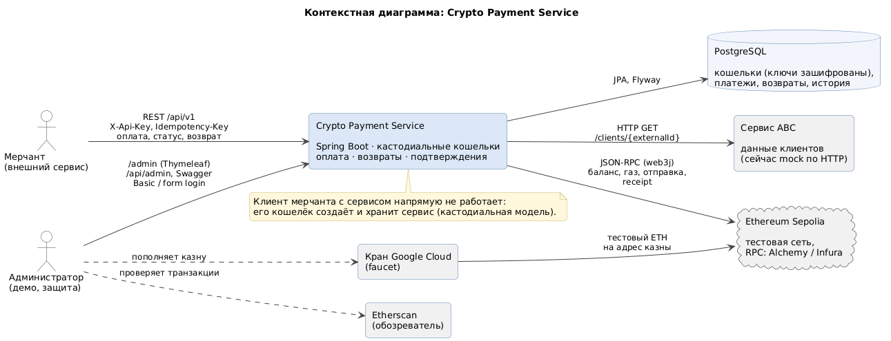

# Требования: Crypto Payment Service

## 1. Назначение и границы

Сервис принимает от мерчантов (внешних сервисов) запросы на оплату: «списать с моего клиента N». Платежи проводятся
в криптовалюте — тестовом ETH сети **Ethereum Sepolia**. Сервис хранит кошельки клиентов и мерчантов сам
(**кастодиальная модель**), проверяет клиента во внешнем «сервисе ABC», проверяет баланс, отправляет транзакцию и
отслеживает её подтверждение. Поддерживаются возвраты по подтверждённым платежам.

Вне границ системы: сама блокчейн-сеть, кран (faucet), сервис ABC (в проекте — mock), бизнес мерчанта.

## 2. Действующие лица

| Действующее лицо | Как взаимодействует |
|---|---|
| **Мерчант** (внешний сервис) | REST API `/api/v1`, аутентификация заголовком `X-Api-Key` |
| **Администратор** | админ-панель `/admin` (form login), REST `/api/admin` и Swagger (Basic Auth) |
| **Клиент мерчанта** | с сервисом напрямую не взаимодействует; его кошелёк создаёт и хранит сервис |
| **Сервис ABC** | внешний источник данных клиента (ФИО, страна, статус ACTIVE/BLOCKED), вызывается по HTTP |
| **Ethereum Sepolia** | сеть, куда отправляются транзакции (через RPC-узел, web3j) |
| **Кран Google Cloud** | источник тестового ETH для казны (пополняет администратор вручную) |

## 3. Функциональные требования

### FR-1. Оплата
**Сценарий:** мерчант отправляет `POST /api/v1/payments` с `{ clientId, amount }` и заголовком `Idempotency-Key`.

1. Сервис проверяет, что клиент с таким `externalId` существует и у него есть кошелёк.
2. Запрашивает данные клиента у сервиса ABC; клиент `BLOCKED` — отказ.
3. Проверяет баланс кошелька клиента: `balance ≥ amount + комиссия сети`.
4. Отправляет транзакцию с кошелька клиента на кошелёк мерчанта, не дожидаясь блока.
5. Возвращает `201 { paymentId, status: PENDING, txHash, explorerUrl }`.

**Критерии приёмки:**
- каждый шаг переводит платёж в следующий статус и пишется в историю (см. FR-6);
- любая ошибка на шагах 1–4 переводит платёж в `FAILED` и возвращает `{ code, message, paymentId, status: FAILED }`;
- при нехватке денег в сообщении указано, сколько не хватает;
- сумма — строка с не более чем 18 знаками после запятой, больше нуля, иначе `INVALID_AMOUNT` (платёж не создаётся).

| Ситуация | Код | HTTP |
|---|---|---|
| клиент не найден | `CLIENT_NOT_FOUND` | 404 |
| у клиента нет кошелька | `WALLET_NOT_FOUND` | 422 |
| клиент заблокирован в ABC | `CLIENT_BLOCKED` | 422 |
| ABC недоступен | `CLIENT_DATA_UNAVAILABLE` | 503 |
| не хватает на сумму + комиссию | `INSUFFICIENT_FUNDS` | 422 |
| ошибка RPC / узел отклонил транзакцию | `BLOCKCHAIN_ERROR` | 502 |

### FR-2. Идемпотентность
- `Idempotency-Key` обязателен для создания оплаты и возврата (`VALIDATION_ERROR`, если его нет).
- Повтор с тем же ключом и тем же телом возвращает **тот же результат** (тот же платёж или ту же ошибку) и
  **повторно не списывает** деньги.
- Тот же ключ с другим телом → `IDEMPOTENCY_CONFLICT` (409).
- Уникальность ключа: для платежей — в пределах мерчанта, для возвратов — в пределах платежа.

### FR-3. Просмотр платежей мерчантом
- `GET /api/v1/payments/{id}` — статус платежа; чужой платёж выглядит как несуществующий (`PAYMENT_NOT_FOUND`).
- `GET /api/v1/payments?status=&page=&size=` — список своих платежей, новые сверху, с фильтром по статусу.

### FR-4. Возврат
**Сценарий:** `POST /api/v1/payments/{id}/refunds` с необязательным `{ amount }` и `Idempotency-Key`.

- Разрешён только для платежей в статусе `CONFIRMED` или `PARTIALLY_REFUNDED`, иначе `INVALID_STATE` (409).
- Без `amount` возвращается весь остаток.
- Сумма всех возвратов, кроме `FAILED`, не превышает сумму платежа, иначе `REFUND_EXCEEDS_PAYMENT` (422).
- Возврат — новая транзакция с кошелька мерчанта на кошелёк клиента; комиссию платит мерчант.
  Если у мерчанта не хватает на сумму + комиссию — возврат `FAILED` с `INSUFFICIENT_FUNDS`.
- `GET /api/v1/payments/{id}/refunds` — список возвратов по платежу.

### FR-5. Подтверждение транзакций
- Фоновая задача раз в ~15 секунд проверяет `PENDING` платежи, возвраты и раздачи из казны.
- Транзакция в блоке и успешна → платёж `CONFIRMED`, возврат и раздача `COMPLETED`.
- Транзакция откатилась (reverted) → `FAILED` (`BLOCKCHAIN_ERROR`).
- Нет подтверждения дольше 10 минут (настраивается) → `FAILED` с `CONFIRMATION_TIMEOUT`.
- После подтверждения возврата платёж становится `PARTIALLY_REFUNDED` или `REFUNDED` (по сумме завершённых возвратов).

### FR-6. Статусы и аудит
- Переходы статусов платежа — только через `PaymentStateMachine`; недопустимый переход → `INVALID_STATE`.
- Каждый переход сохраняется в `payment_status_history` (из какого статуса, в какой, время, комментарий).
- Диаграммы: [статусы платежа](diagrams/state-payment.png), [статусы возврата](diagrams/state-refund.png).

### FR-7. Казна
- При первом старте сервис сам создаёт кошелёк казны (один на систему).
- Администратор пополняет казну тестовым ETH из крана; из казны ETH раздаётся клиентам и мерчантам.
- Перевод из казны при нехватке денег → `TREASURY_INSUFFICIENT_FUNDS`.
- `GET /api/admin/treasury` — адрес и баланс казны.

### FR-8. Управление клиентами и мерчантами (администратор)
- Создать клиента (`externalId`, по желанию сразу с кошельком), создать кошелёк существующему клиенту,
  пополнить клиента из казны, посмотреть баланс.
- Создать мерчанта: создаётся кошелёк, ему переводится немного ETH из казны на комиссии за возвраты,
  возвращается API-ключ — **один раз**; в базе хранится только хэш ключа.

### FR-9. Админ-панель (Thymeleaf)
- Казна: адрес с кнопкой «скопировать» и ссылкой на etherscan, баланс, инструкция по крану.
- Клиенты: таблица (external id, адрес, баланс), создание, кошелёк, пополнение из казны.
- Мерчанты: таблица (адрес, баланс), создание, показ API-ключа один раз.
- Платежи: таблица с цветными статусами, ссылками на транзакции и фильтром; страница платежа с историей,
  возвратами и кнопкой «Вернуть».
- Тестовая оплата: форма «мерчант / клиент / сумма», вызывает тот же сценарий, что и REST API.

### FR-10. Mock сервиса ABC
- `GET /mock-abc/clients/{externalId}` → `{ externalId, fullName, email, country, status }`.
- Данные из seed-файла; `ext-blocked` — `BLOCKED`; `unknown-*` — 404; `unavailable-*` — 503 (для демонстрации ошибок).
- Основное приложение обращается к нему **по HTTP** (`ABC_BASE_URL`), как к настоящему внешнему сервису.

## 4. Нефункциональные требования

| Категория | Требование | Как выполнено |
|---|---|---|
| Безопасность | приватные ключи только в зашифрованном виде | AES-256-GCM, мастер-ключ `WALLET_ENCRYPTION_KEY` из окружения (`AesGcmPrivateKeyCipher`) |
| | приложение не стартует без ключа | проверка при создании бина + понятное сообщение (`InvalidEncryptionKeyFailureAnalyzer`) |
| | секреты не попадают в код, git, логи и ответы | `.env` в `.gitignore`; `toString()` моделей скрывает ключи; URL RPC логируется без API-ключа |
| | API-ключи мерчантов не хранятся в открытом виде | хранится SHA-256 хэш, ключ показывается один раз |
| | доступ администратора | Basic Auth для `/api/admin`, form login + CSRF для `/admin`, пароль `ADMIN_PASSWORD` |
| Надёжность | нет двойного списания при повторе запроса | идемпотентность: уникальный индекс + хэш тела запроса |
| | нет конфликтов nonce и двойной траты | отправки с одного адреса — последовательно (блокировка по адресу) + локальный учёт nonce |
| | медленный или ограниченный RPC не роняет сервис | таймауты HTTP, ошибки RPC → `BLOCKCHAIN_ERROR`, планировщик не чаще раза в 15 с, ошибка по одной транзакции не мешает остальным |
| | согласованность статуса и истории | платёж и запись истории сохраняются в одной транзакции БД |
| Наблюдаемость | каждый шаг оплаты в логах | логи с `[payment=<id>]`, история статусов в БД |
| Сопровождаемость | расширяемость к финалу | гексагональная архитектура, порты, модуль на каждый use case (см. `architecture.md`) |
| Тестируемость | тесты без сети | fake-блокчейн, in-memory репозитории; интеграционные тесты на Testcontainers (PostgreSQL) |
| Переносимость | запуск одной командой | Docker (multi-stage) + docker-compose (app + postgres) |
| Конфигурируемость | без пересборки | `application.yml` + переменные окружения, профили `fake` / `sepolia` |
| Точность сумм | без ошибок округления | только `BigDecimal`, в БД `NUMERIC(36,18)`, в JSON суммы строками |

## 5. Ограничения

- Сеть Ethereum **Sepolia**, валюта — тестовый ETH (не имеет стоимости).
- Стек: Java 21, Spring Boot 3.5, Maven, PostgreSQL 16 + Flyway, web3j, Thymeleaf, Docker.
- Без внешних провайдеров кошельков и платных сервисов (RPC — бесплатный узел или бесплатный ключ Alchemy/Infura).
- Публичный RPC может быть медленным и ограничивать частоту запросов.
- Один экземпляр приложения (блокировки отправок — в памяти процесса).

## 6. Допущения

- Сервис ABC доверенный; его недоступность — временная ошибка (`CLIENT_DATA_UNAVAILABLE`), платёж не проводится.
- Кошельки клиентам и мерчантам создаёт сервис (администратор); собственных кошельков пользователи не подключают.
- Комиссию сети за платёж платит клиент (отправитель), за возврат — мерчант, за раздачу — казна.
- Комиссия оценивается у сети перед каждой отправкой (лимит газа и цена газа с запасом 20%).
- Валюта одна — ETH; токены (ERC-20) не поддерживаются.
- Мерчант узнаёт о подтверждении, опрашивая `GET /payments/{id}` (webhook-уведомлений нет).
- Демо-развёртывание по HTTP; для реального использования нужен TLS.

## 7. Коды ошибок

| Код | HTTP | Когда |
|---|---|---|
| `UNAUTHORIZED` | 401 | нет или неверный `X-Api-Key` / пароль администратора |
| `VALIDATION_ERROR` | 400 | неверный запрос, нет `Idempotency-Key` |
| `INVALID_AMOUNT` | 400 | сумма ≤ 0 или точнее 1 wei |
| `CLIENT_NOT_FOUND` | 404 | клиента нет |
| `PAYMENT_NOT_FOUND` | 404 | платежа нет или он чужой |
| `MERCHANT_NOT_FOUND` | 404 | мерчанта нет (админ-панель) |
| `CLIENT_ALREADY_EXISTS` | 409 | клиент с таким `externalId` уже есть |
| `INVALID_STATE` | 409 | недопустимый переход статуса / возврат по неподтверждённому платежу |
| `IDEMPOTENCY_CONFLICT` | 409 | тот же ключ с другим телом |
| `WALLET_NOT_FOUND` | 422 | у клиента нет кошелька / казна не создана |
| `CLIENT_BLOCKED` | 422 | ABC вернул `BLOCKED` |
| `INSUFFICIENT_FUNDS` | 422 | не хватает на сумму + комиссию |
| `TREASURY_INSUFFICIENT_FUNDS` | 422 | в казне не хватает денег |
| `REFUND_EXCEEDS_PAYMENT` | 422 | возвраты превысили бы сумму платежа |
| `CONFIRMATION_TIMEOUT` | — | транзакция не подтвердилась вовремя (в статусе платежа/возврата) |
| `CLIENT_DATA_UNAVAILABLE` | 503 | сервис ABC недоступен |
| `BLOCKCHAIN_ERROR` | 502 | ошибка RPC-узла / транзакция отклонена или откатилась |
| `INTERNAL_ERROR` | 500 | непредвиденная ошибка |
